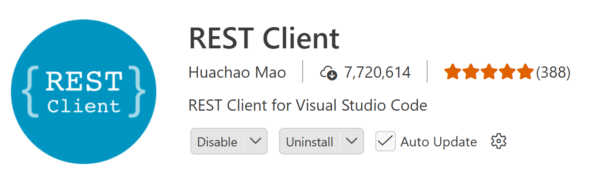

# Lesson 18 - REST and JSON

- **HTTP** - HyperText Transfer Protocol
  - We send/receive *text* over the internet/network
  - *HTTPS* - Secured version of HTTP
- **API** - Application Programming Interface
  - A bit of "loaded" term, because how you define it depends on the context in which you are using it
    - Some 3rd-party library of code that they are using
    - Code that we can use/call because our environment provides APIs
      - DOM API - `document.querySelector()`, etc.
  - In today's topic, we're talking about the **endpoints** made available for getting data over the network
- **REST** - Representation State Transfer
  - Key to REST APIs are the *verbs* or ***actions*** supported by HTTP
    - GET (the *default*)
    - POST - send new information (think of SQL `insert`)
    - PUT - send updated information - to replace some "things" in their entirety
    - PATCH - send updated information - to update one field/property
    - DELETE - remove information
    - QUERY - like a GET, but with the ability to specify search criteria in the *body* of the request
  - These verbs/actions/methods are available as the *intent* of the request
  - (Not all API endpoints on the web are built as REST APIs)
- **URL** - Uniform Resource Locator
- **URI** - Uniform Resource Identifier

## JSON Endpoints

JSON is a kind of *subset* of JavaScript. It's a lot like JavaScript *object literal syntax*. JSON is more restrictive than JavaScript. JSON is all about **representing data**.

JSON files have the extension of `.json`.

> **J**ava**S**cript **O**bject **N**otation

- When we talk about JSON, we're talking about a *string* representation of *JavaScript data*.
- Data properties are stored as name/value pairs.
  - Property names must be in double quotes.
  - Property values can be either
    - strings (stored in double quotes)
    - numbers
    - boolean (`true`/`false`)
    - arrays
    - objects
    - `null`
- When you have JSON, you have either an **object** or an **array**.
- JSON does not allow for
  - comments
  - trailing commas
  - semicolons
  - functions
  - variables
  - expressions

## Compare and Contrast

```js
// JavaScript object literal
const orbit = 365.25;
const body = {
    name: 'Earth',
    category: 'planet',
    orbitalPeriod: `${orbit} Earth days`,
};
```

```json
{
    "name": "Earth",
    "category": "planet",
    "orbitalPeriod": "365.25 Earth days"
}
```

## Localhost and Ports

> `http://localhost:5173` is an example of using LocalHost which refers to *your ***local*** computer* on the network.

- A human-readable web address must be associated with an IP address for the computers to connect.
  - This is done through a **DNS** server (Domain Name Server)
- IP Address (IPV4 or IPV6) - Identify a specific computer on the network
- Port - A specific entry point into that computer
  - The default port for `http://` is **80**. The default port for `https://` is **443**.
  - When you enter `https://DG-InClass.github.io`, the browser reads it as `https://DG-InClass.github.io:443`.
  - An IP Address and port constitute a **socket**.
- A special "domain name" is `localhost`, which maps to the IP address of `127.0.0.1` - the *home* address - **your computer**
  - An example would be `http://localhost:3000`

----

## REST Client Extension for VS Code



## Serving JSON

A nice dev-suitable library for serving JSON data:

```ps
pnpm add -D -E json-server@1.0.0-beta.15
```
